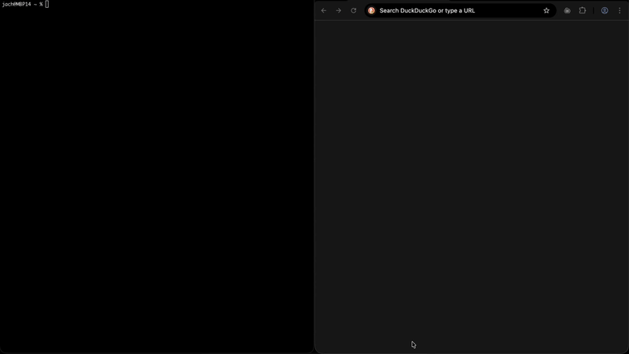

# OpenCode Browser MCP Plugin

An OpenCode plugin that integrates [Browser MCP](https://browsermcp.io) to enable browser automation capabilities within OpenCode. This plugin allows the AI to control a browser, navigate websites, fill forms, click elements, and perform other browser automation tasks.

Works with both **OpenCode 1** (1.18.29+) and **OpenCode 2**.

## Demo



## Features

- Full browser automation support through Browser MCP
- **OpenCode 1 and 2 support** from one package
- **Speed-oriented browser guidance** injected into the model prompt
- **Tool-specific performance hints** for expensive browser actions
- **Fast retry behavior** with no artificial reconnect backoff in the plugin
- Automatic detection of browser-related tasks
- Context preservation for browser state across session compactions
- Seamless integration with OpenCode's existing tools

## Prerequisites

Before using this plugin, you need:

1. **Node.js** installed on your system
2. **OpenCode 1.18.29+ or OpenCode 2** installed and configured
3. **Browser MCP extension** installed in your browser (Chrome/Edge)

## Installation

### Step 1: Install Browser MCP Extension

1. Visit [https://browsermcp.io/install](https://browsermcp.io/install)
2. Install the Browser MCP extension for your browser (Chrome or Edge)
3. Follow the extension setup instructions

### Step 2: Configure OpenCode

Fastest path:

```bash
npx opencode-browser init
```

This creates or updates `./opencode.json` with the required `plugin` and `mcp.browsermcp` entries while preserving any unrelated config you already have.

For a global setup instead of a project-local one:

```bash
npx opencode-browser init --global
```

If you prefer to preview the generated config without writing it yet:

```bash
npx opencode-browser init --print
```

Or configure it by hand. Create or update your `opencode.json` configuration file. You can create this file in one of two locations:

- **Global configuration** (applies to all projects): `~/.config/opencode/opencode.json`
- **Project-specific configuration** (applies to current project only): `./opencode.json` (in your project root)

Learn more about OpenCode configuration at [https://opencode.ai/docs/config](https://opencode.ai/docs/config)

Add this configuration to your `opencode.json`:

```json
{
  "$schema": "https://opencode.ai/config.json",
  "plugin": ["opencode-browser"],
  "mcp": {
    "browsermcp": {
      "type": "local",
      "command": ["npx", "-y", "@browsermcp/mcp@0.1.3"],
      "enabled": true
    }
  }
}
```

This configuration does two things:
1. **Installs the plugin** - OpenCode automatically downloads `opencode-browser` from npm
2. **Configures Browser MCP** - Sets up the MCP server that actually controls the browser

That's it! No manual file copying required. OpenCode handles everything automatically.

The generated command pins the Browser MCP package version to avoid the extra `@latest` resolution step on startup and keep launches reproducible.

### OpenCode 2

The plugin ships a single package that supports both OpenCode 1 and OpenCode 2. OpenCode 2 reads the plugin's V2 definition and registers the same guidance through its session, tool, and event APIs; existing `plugin` configuration keeps working because OpenCode 2 normalizes V1 configuration.

To use the native V2 configuration shape, move the entry from `plugin` to `plugins` and use the V2 MCP shape:

```jsonc
{
  "$schema": "https://opencode.ai/config.json",
  "plugins": ["opencode-browser"],
  "mcp": {
    "servers": {
      "browsermcp": {
        "type": "local",
        "command": ["npx", "-y", "@browsermcp/mcp@0.1.3"],
        "disabled": false
      }
    }
  }
}
```

No runtime dependencies are required: the plugin's imports of the OpenCode plugin type packages are type-only, so it loads under both APIs without installing `@opencode/plugin` or `@opencode-ai/plugin` into the plugin folder.

If OpenCode 2 reports `Plugin must export a default definition with an id and an effect or setup function`, you are running a version older than 1.3.0. Update the plugin (`opencode plugin update`, or clear OpenCode's package cache) and restart.

#### Alternative: Install Locally (for development/testing)

If you want to modify the plugin or test changes:

**OpenCode 2:** point the config at your clone. The path must be the package directory, not `src/index.ts`:

```json
{
  "$schema": "https://opencode.ai/config.json",
  "plugin": ["file:///absolute/path/to/opencode-browser"]
}
```

**OpenCode 1, global installation:**
```bash
mkdir -p ~/.config/opencode/plugins
cp src/index.ts ~/.config/opencode/plugins/browser-mcp.ts
```

**OpenCode 1, project-specific installation:**
```bash
mkdir -p .opencode/plugins
cp src/index.ts .opencode/plugins/browser-mcp.ts
```

The plugin will be automatically loaded on OpenCode startup.

## Configuration

### Basic Configuration

The minimal configuration requires only the MCP server setup:

```json
{
  "$schema": "https://opencode.ai/config.json",
  "mcp": {
    "browsermcp": {
      "type": "local",
      "command": ["npx", "-y", "@browsermcp/mcp@0.1.3"],
      "enabled": true
    }
  }
}
```

### Advanced Configuration

For more control, you can disable Browser MCP tools globally and enable them per agent:

```json
{
  "$schema": "https://opencode.ai/config.json",
  "mcp": {
    "browsermcp": {
      "type": "local",
      "command": ["npx", "-y", "@browsermcp/mcp@0.1.3"],
      "enabled": true
    }
  },
  "tools": {
    "browsermcp_*": false
  },
  "agent": {
    "browser-agent": {
      "tools": {
        "browsermcp_*": true
      }
    }
  }
}
```

### Performance Behavior

The plugin improves Browser MCP speed by shaping how the model uses browser tools:

- Adds system guidance that prefers direct navigation and fewer browser calls
- Annotates expensive tools like snapshots, screenshots, and waits with performance hints
- Preserves fast-resume guidance during session compaction
- Avoids plugin-side reconnect delays so you can retry immediately when the browser extension is ready

### Environment Variables

If you need to pass environment variables to the Browser MCP server:

```json
{
  "$schema": "https://opencode.ai/config.json",
  "mcp": {
    "browsermcp": {
      "type": "local",
      "command": ["npx", "-y", "@browsermcp/mcp@0.1.3"],
      "enabled": true,
      "environment": {
        "BROWSER_MCP_DEBUG": "true"
      }
    }
  }
}
```

## Usage

Once installed and configured, you can use browser automation in your OpenCode prompts:

### Basic Browser Navigation

```
Navigate to https://github.com and search for "opencode"
```

### Form Filling

```
Go to the contact form at https://example.com/contact and fill in:
- Name: John Doe
- Email: john@example.com
- Message: Hello from OpenCode!
Then submit the form.
```

### Web Scraping

```
Visit https://news.ycombinator.com and get the titles of the top 5 stories
```

### Complex Automation

```
Go to https://example.com/login, log in with the test credentials,
navigate to the dashboard, and screenshot the main metrics panel
```

### Prompt Tips

For best results when using browser automation:

1. **Be specific** about URLs and actions
2. **Prefer direct URLs** instead of clicking through intermediate pages
3. **Reuse page state** instead of rechecking the same screen repeatedly
4. **Ask for verification only when needed** because snapshots and screenshots are slower than targeted extraction
5. **Specify selectors** when needed (CSS selectors, text content, etc.)

You can also add browser automation guidelines to your `AGENTS.md` file:

```markdown
## Browser Automation

When performing browser automation tasks:
- Always confirm the page has loaded before interacting
- Use descriptive selectors (prefer text content over CSS selectors)
- Take screenshots when verification is needed
- Handle errors gracefully (page not found, element not visible, etc.)
- Close tabs when the task is complete
```

## Plugin Features

### Speed-Oriented Guidance

The plugin biases the model toward faster browser workflows:

- Prefers direct `navigate` calls when the destination URL is known
- Reuses the current tab and page state instead of redoing navigation
- Minimizes `snapshot`, `screenshot`, and `wait` calls unless they are actually needed
- Encourages targeted extraction and direct actions over broad inspection

### Lightweight Connection Recovery

The plugin still detects browser connection issues, but it no longer adds artificial retry sleeps:

- Detects common Browser MCP connection failures from tool output
- Adds immediate retry guidance to the result instead of pausing inside the plugin
- Marks the connection as restored after the next successful browser action

### Automatic Browser Tool Detection

The plugin automatically detects when Browser MCP tools are being used and applies browser-specific guidance.

### Session Context Preservation

During session compaction, the plugin preserves browser automation context, ensuring the AI remembers:
- Browser interactions that occurred
- Current browser state considerations
- Fast-resume guidance so it can avoid repeating navigation and inspection

### Tool Definition Hints

The plugin annotates Browser MCP tool definitions with performance notes, especially for slower tools like snapshots, screenshots, and waits.

## Troubleshooting

### Browser MCP Connection Lost

If you see connection errors:

1. **Check extension status**: Verify the Browser MCP extension is enabled in Chrome
2. **Re-enable extension**: If you disabled it, simply re-enable it and retry the browser action immediately
3. **Check browser is running**: Ensure Chrome/Edge is actually running
4. **Retry after readiness**: The plugin does not add extra backoff delay, so the next attempt can run right away
5. **Restart only if needed**: Restart OpenCode only if the browser stays unavailable after retrying

The plugin will display messages like:
- `[Browser MCP] The browser connection looks unavailable. Re-enable the Browser MCP extension or browser, then retry.`
- `[Browser MCP] Connection restored. Continuing without extra retry delay.`

### Browser MCP Not Working

1. **Check extension is installed**: Open your browser and verify the Browser MCP extension is installed and enabled
2. **Verify MCP server config**: Ensure your `opencode.json` has the correct MCP configuration
3. **Check Node.js**: Ensure Node.js is installed: `node --version`
4. **Test MCP connection**: Restart OpenCode after adding the MCP configuration

### Plugin Not Loading

1. **Check the version**: OpenCode 2 needs `opencode-browser` 1.3.0 or newer
2. **Check file location**: Ensure the plugin file is in the correct directory. On OpenCode 2, a `file://` plugin path must point to the package directory
3. **Check file name**: Plugin files should end in `.ts` or `.js`
4. **Check syntax**: Ensure the TypeScript/JavaScript syntax is valid
5. **Check logs**: Look for plugin initialization messages in OpenCode output

### Tools Not Available

1. **Check MCP server status**: Ensure the Browser MCP server started successfully
2. **Check tool configuration**: Verify tools aren't disabled in your config
3. **Restart OpenCode**: Try restarting OpenCode after configuration changes

### Debug Mode

Enable debug logging by modifying the plugin or checking OpenCode logs:

```bash
# OpenCode 2: print server logs while running a prompt
opencode run --standalone --print-logs --log-level debug "your prompt"

# OpenCode 1
opencode --verbose
```

## Development

### Building from Source

If you want to modify the plugin:

1. Clone the repository
2. Make your changes to `src/index.ts`
3. Run `npm run typecheck` and `npm test` (covers both the OpenCode 1 and OpenCode 2 entrypoints)
4. Test locally with a `file://` plugin path (see [Install Locally](#alternative-install-locally-for-developmenttesting))
5. Submit a PR if you'd like to contribute!

### Plugin Architecture

The package default-exports one definition with two entrypoints that share the same state and guidance text: `id` + `setup()` for OpenCode 2, and `server()` for OpenCode 1.

| Purpose | OpenCode 1 hook | OpenCode 2 API |
| --- | --- | --- |
| Inject speed-oriented browser guidance | `experimental.chat.system.transform` | `ctx.session.hook("context")` |
| Add performance hints to Browser MCP tools | `tool.definition` | `ctx.tool.transform` |
| Post-process browser tool results | `tool.execute.after` | `ctx.tool.hook("execute.after")` |
| Preserve browser context | `experimental.session.compacting` | `ctx.session.hook("compaction")` |
| Clean up session state | `event` | `ctx.event.subscribe()` |

On OpenCode 2, browser tools called from Code Mode are reported on the `execute` result's nested `toolCalls`, which the plugin also reads so connection recovery hints still work.

## Contributing

Contributions are welcome! Please:

1. Fork the repository
2. Create a feature branch
3. Make your changes
4. Submit a pull request

## Resources

- [Browser MCP Documentation](https://docs.browsermcp.io/)
- [OpenCode Documentation](https://opencode.ai/docs/)
- [OpenCode Plugin Guide](https://opencode.ai/docs/plugins/)
- [MCP Servers in OpenCode](https://opencode.ai/docs/mcp-servers/)

## License

MIT License - See LICENSE file for details

## Support

For issues and questions:

- Browser MCP issues: [Browser MCP GitHub](https://github.com/browsermcp/browser-mcp)
- OpenCode issues: [OpenCode GitHub](https://github.com/anomalyco/opencode)
- Plugin issues: Open an issue in this repository

## Changelog

See [CHANGELOG.md](CHANGELOG.md) for a detailed list of changes in each version.
